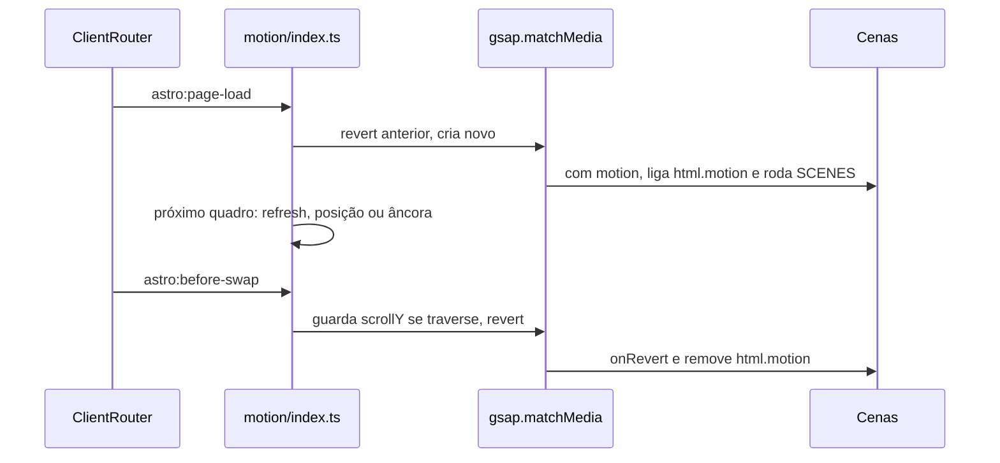
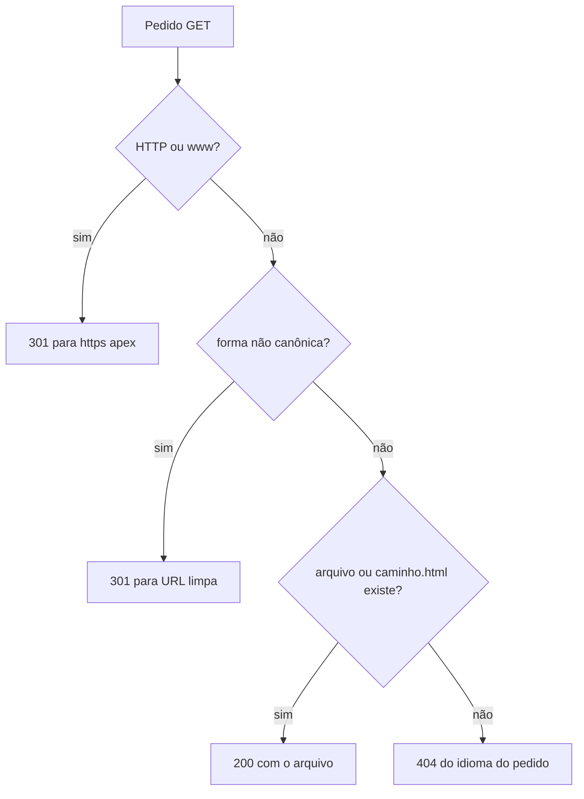

# Arquitetura

> **Status (2026-11-27):** construído: site estático em Astro com as 57 páginas nos três idiomas, motion GSAP das sete seções da home e da página de projeto, regras de hospedagem em `public/.htaccess`, checagens de build, testes de unidade e ponta a ponta, CI de pull request; desenhado, não construído: nada pendente no código; falta validar as regras no LiteSpeed de produção ([ROADMAP.md](./ROADMAP.md)).

## Visão geral

O site é gerado inteiro no build (`output: 'static'`, `build.format: 'file'`, `trailingSlash: 'never'` em `astro.config.mjs`). Cada página vira um `<caminho>.html` em `dist/`: `index.html`, `en.html`, `es.html`, `projetos/<slug>.html`, `en/projects/<slug>.html`, `es/proyectos/<slug>.html`, as três `404.html`, mais `sitemap.xml` e `llms.txt` (resumo do site em Markdown, formato llmstxt.org).

Em produção, o servidor da hospedagem compartilhada (LiteSpeed, que lê `.htaccess`) serve esses arquivos em URLs limpas pelas regras de `public/.htaccess`, copiado para `dist/` no build. Não há servidor de aplicação, banco ou API.

No navegador, o `<ClientRouter />` do Astro (`src/layouts/Base.astro`) faz as navegações internas sem recarregar a página, com transições nomeadas entre o cartão do projeto e a capa da página dele. O motion (`src/motion/`) liga por cima de um HTML que já é completo sem JavaScript.

## Estrutura

```
portfolio/
├── astro.config.mjs          # saída estática, i18n, Tailwind e Paraglide no Vite
├── project.inlang/           # configuração do Paraglide (idiomas, módulo de mensagens)
├── messages/                 # texto de interface: pt-br.json, en.json, es.json
├── public/                   # copiado como está: .htaccess, PDFs do currículo, og/, robots.txt
├── src/
│   ├── pages/                # rotas: index, en/, es/, projetos/, sitemap.xml.ts, llms.txt.ts, 404
│   ├── layouts/Base.astro    # <head>, SEO, tema antes da pintura, ClientRouter, carga do motion
│   ├── components/           # HomePage, ProjectPage, Header, Drawer, Tip, Icon, LangSwitch, ThemeToggle
│   │   ├── sections/         # as sete seções da home
│   │   └── fx/               # fundo: névoa e efeitos
│   ├── motion/               # index.ts (ciclo de vida), scene.ts (contrato), uma cena por seção
│   ├── data/                 # fatos: projetos, experiências, competências, tecnologias, ícones, contatos
│   ├── content/projects/     # <locale>/<slug>.md: resumo e descrição de cada projeto por idioma
│   ├── lib/                  # projects.ts, seo.ts, format.ts
│   ├── i18n/                 # locales.ts, routes.ts
│   ├── assets/               # imagens e ícones de tecnologia (passam pelo <Image>)
│   ├── styles/global.css     # tokens dos dois temas e regras globais
│   └── middleware.ts         # idioma padrão do Paraglide por pedido
├── scripts/                  # check-messages.mjs, check-dist.mjs, check-apache.sh, og-image.mjs, apache/
├── tests/
│   ├── unit/                 # Vitest
│   └── e2e/                  # Playwright, contra o dist/
├── .github/workflows/        # ci.yml (PR), deploy.yml e publish.yml (push na main)
└── old/                      # site anterior (React + Vite), arquivo com package.json próprio
```

## Componentes

| Componente | Responsabilidade | Mora em |
|---|---|---|
| Rotas por idioma | uma página `.astro` fina por rota, que chama `HomePage`, `ProjectPage` ou `NotFound` com o `locale` | `src/pages/` |
| Layout base | `lang`, canonical, `hreflang` recíproco e `x-default`, Open Graph, JSON-LD, tema antes da primeira pintura, `ClientRouter`, import do motion | `src/layouts/Base.astro` |
| Caminhos | `homePath`, `projectPath`, `notFoundPath`, `pagePath`, `alternates` (mesma página nos três idiomas) | `src/i18n/routes.ts` |
| Fatos | 17 projetos, 4 experiências, 31 competências, mapa de tecnologias e de ícones | `src/data/` |
| Texto por idioma | mensagens de interface (110 chaves por idioma) e um `.md` por projeto e idioma | `messages/`, `src/content/projects/` |
| Projetos | junta fatos e texto; falha o build se faltar o arquivo ou a descrição num idioma | `src/lib/projects.ts`, `src/content.config.ts` |
| SEO | títulos, descrições, JSON-LD (`Person`, `WebSite`, `ProfilePage`, `ItemList`, `CreativeWork`) | `src/lib/seo.ts` |
| Rotas geradas | `sitemap.xml` e `llms.txt` (em português, com ponteiros para EN e ES) | `src/pages/sitemap.xml.ts`, `src/pages/llms.txt.ts` |
| Motion | um `gsap.matchMedia()`, as cenas em ordem do DOM, revert completo | `src/motion/index.ts`, `src/motion/scene.ts` |
| Hospedagem | HTTPS, apex, URL limpa, legado, 404 por idioma, cache | `public/.htaccess` |
| Checagens | mensagens, `dist/` e regras de hospedagem | `scripts/` |
| Deploy | build e `rsync --delete` para a Hostinger; cópia do `dist/` na branch `build` | `.github/workflows/` |

## Ciclo de vida do motion



**Restrições:**

- As quatro condições são `desktop` (`min-width: 768px`), `mobile` (`max-width: 767.98px`), `motion` (`prefers-reduced-motion: no-preference`) e `cursor` (`hover: hover` e `pointer: fine`). Sem `motion`, nenhuma cena roda e a classe não é ligada.
- Mudar breakpoint ou preferência de movimento reverte tudo e roda de novo; a âncora só é reaplicada na primeira rodada da página.
- `SCENES` segue a ordem do DOM (`fx, hero, about, experience, stage, list, skills, contact, page`); cada cena procura os próprios elementos e não faz nada onde eles não existem (a página do projeto não tem as seções da home).
- No quadro seguinte às cenas, a ordem é fixa: `ScrollTrigger.refresh()` primeiro, depois a posição salva (navegação pelo histórico) ou `scrollIntoView` no `#hash`. As posições são refeitas também quando `document.fonts.ready` resolve.
- Se uma cena lança erro, o `matchMedia` é revertido num microtask e a página fica no layout estático até a próxima navegação.
- `ScrollTrigger.config({ ignoreMobileResize: true })`: a barra de endereço do celular não recalcula as cenas.
- No desktop há três pins (Sobre, Experiência, palco); no celular nenhum, só `position: sticky`.

## Resolução de uma URL no servidor



**Restrições:**

- "Forma não canônica" é, na ordem do arquivo: `/projeto-<slug>.html` do site antigo (para `/projetos/<slug>`), um `.html` pedido de fato (detectado por `%{THE_REQUEST}`, para não repetir o redirect depois da reescrita interna), `/index` e qualquer barra final. Query string é preservada.
- `DirectorySlash Off` vale antes de tudo: sem ele o mod_dir redireciona `/en` para `/en/`.
- `/404` e `/en/404` nunca viram página: respondem 404. `/404.html` responde 200 (é o alvo do `ErrorDocument`).
- Uma pasta sem `.html` correspondente (`/projetos`, `/en/projects`) é 404, não listagem nem 403.
- A 404 é `ErrorDocument 404 /404.html`; o redirect interno é reescrito para `en/404.html` ou `es/404.html` conforme o pedido original em `%{THE_REQUEST}`.
- `.html` e `.pdf` saem com `Cache-Control: no-cache`; `_astro/*` tem hash no nome. `.txt` sai como `text/plain; charset=utf-8`.
- O bloco entre `# só-produção: início` e `# só-produção: fim` (HTTPS e www) é removido pelo `check-apache.sh` no teste local.
- Tudo isso está provado em Apache 2.4; no LiteSpeed de produção, veja [PITFALLS.md](./PITFALLS.md#produção-em-litespeed-com-regras-testadas-em-apache).

## Decisões de projeto

- **Tipografia em trânsito como base, com um palco só para os 5 destaques.** A tipografia gigante é o motion e a foto é o único objeto; o palco concentra a ousadia num momento com imagem real. Uma alternativa com metáfora de fila de mensagens foi descartada por ser técnica demais para quem não é dev.
- **Saída estática com `build.format: 'file'`.** As URLs canônicas antigas (`/` e `/projetos/<slug>`, sem barra final) não mudam e respondem 200 direto. O custo é a pasta e o `.html` lado a lado, que exige `DirectorySlash Off`.
- **Português na raiz, `/en` e `/es` com segmentos próprios** (`projects`, `proyectos`). O `urlPatterns` do Paraglide e `src/i18n/routes.ts` descrevem o mesmo mapa; o `x-default` aponta para o português.
- **Fatos num lugar só, texto por idioma.** `src/data/` não muda com o idioma; mensagens e `.md` sim. Assim inglês e espanhol não podem divergir nos fatos.
- **Mensagens resolvidas no servidor.** Nenhum JavaScript do navegador carrega o Paraglide; o build confere.
- **Sem cair para o português em silêncio.** Chave ou texto faltando num idioma falha o build (`check-messages.mjs`, `content.config.ts`, `getProjects`), em vez de depender de como o Paraglide trata a falta.
- **HTML completo sem JavaScript.** O motion é uma camada: CSS sob `html.motion` muda o layout, o GSAP põe os estados iniciais. Com movimento reduzido ou sem JS, o layout estático é o mesmo conteúdo.
- **Um `gsap.matchMedia()` como fonte única das variantes.** Desktop e celular podem ter desenho e motion diferentes; trocar de condição reverte tudo.
- **Scroll nativo.** Nenhuma biblioteca de smooth scroll.
- **Tema com a mesma chave do site anterior.** `localStorage` `data-theme`, aplicado por script inline no `<head>` antes da pintura e de novo em `astro:after-swap`; sem escolha salva, segue o sistema.
- **Regras de hospedagem testadas por script.** `check-apache.sh` sobe um `httpd:2.4` em Docker com o mesmo `.htaccess` e confere a tabela de pedidos; o modo `BASE_URL` roda a mesma tabela contra um host real.
- **Merge na `main` é deploy.** O `ci.yml` constrói cada PR sem segredos; o `deploy.yml` só roda na `main` e usa `rsync --delete`, preservando `.well-known`.
- **O site anterior fica em `old/`** como arquivo que ainda instala e constrói sozinho; nada dele entra no `dist/`.
